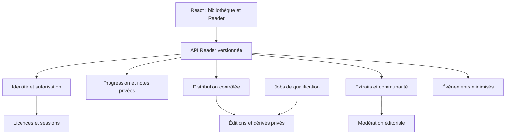
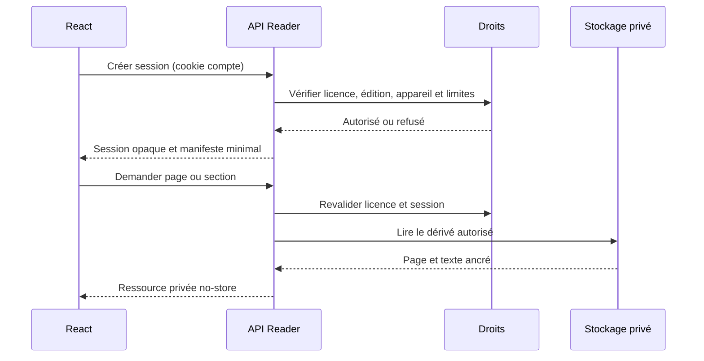
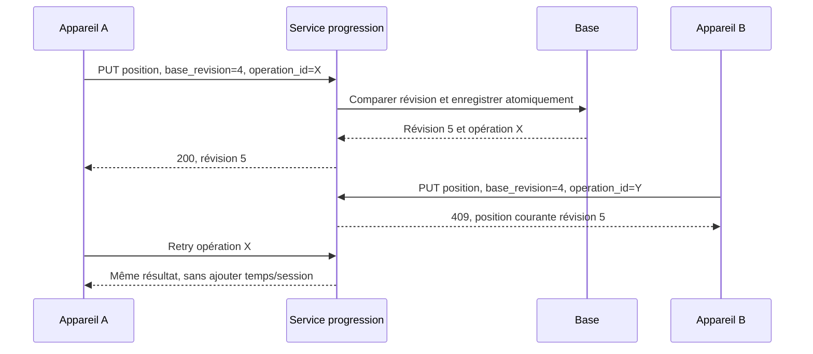

# Architecture logique et technique

## Choix de référence

Monolithe Laravel modulaire. React consomme des DTO JSON versionnés. Un port d'autorisation porte les décisions ; les contrôleurs traduisent HTTP ; les moteurs d'affichage n'accordent jamais de droit. Base relationnelle actuelle conservée. Préparation des documents en jobs Laravel, sans service Python permanent à ce stade. PostgreSQL/Redis et Go restent une trajectoire, pas des prérequis de Reader.

Les dépendances transversales sont l'identité et l'autorisation. Les notes ne dépendent pas de la communauté. Celle-ci reçoit uniquement un extrait explicitement validé, jamais un objet note sérialisé.

| Module | Possède | Port ou frontière |
| --- | --- | --- |
| Identité | Session compte, connexion/déconnexion | Identité serveur ; aucun user_id client accepté comme propriétaire |
| Catalogue | Book, auteur, éditions et droits éditoriaux | Métadonnées publiques séparées des ressources privées |
| Licences | Bénéficiaire, source achat, statut, révocation | ReadingAccess ; achat terminé est l'adaptateur transitoire |
| Bibliothèque | Projection des licences actives et achats historiques | Vue réutilisée par AccountPage et MyLibrary dans un prochain lot |
| Distribution | Sessions Reader, assets autorisés | Manifeste et ressources d'une édition ; aucune URL originale |
| Moteurs | PDF/EPUB, position réelle, extraction | `page`, `text`, `outline`, `locator`, `destroy` ; état React propre par édition |
| Progression | Dernière position, révision et opérations | `reading_progress` unique, transaction atomique à ajouter |
| Outils privés | Notes/surlignages et marque-pages | Propriétaire explicite ; interdiction de publier par ce port |
| Audio | Segment, curseur texte/audio | Moteur TTS interchangeable, pistes enregistrées plus tard |
| Communauté | Publication volontaire, groupe, discussion | Réutilise groupes/messages existants |
| Modération | Règles et retrait d'extraits | Permission de citation et validation serveur |
| Observabilité | Latence, refus et sécurité | Événements structurés sans contenu privé |

## Flux de lecture cible

Le manifeste fondation existe mais répond `pending_secure_derivatives` avec read=false. La session et les pages de ce diagramme sont à implémenter. Les routes historiques continuent à fonctionner séparément et ne doivent pas être présentées comme cette livraison contrôlée.

## Flux de synchronisation cible

Pas de fusion par maximum de page : revenir en arrière est légitime. Le lecteur en conflit propose conserver la position serveur ou remplacer explicitement après relecture. Les durées sont bornées et calculées par fenêtres de session ; pas de valeur cumulée client faisant foi.

## Comparaison des moteurs

Sources primaires consultées le 31 octobre 2026. Les versions exactes seront verrouillées à chaque intégration et réévaluées pour les avis de sécurité.

| Solution | Licence | Usage et performances à mesurer | Limites et décision |
| --- | --- | --- | --- |
| PDF.js | Apache-2.0 | Parsing, canvas, texte, outline ; worker dédié et rendu des pages visibles | Pas un DRM ; données PDF client récupérables. Version 6.4.299 verrouillée pour prototype, worker local. Prévoir CMaps/polices/wasm locaux pour corpus étendu. |
| EPUB.js | BSD-2-Clause | CFI, rendu reflowable et table des matières | EPUB non fiable : scripts désactivés, ressources externes bloquées, nettoyage XHTML et archives. Réévaluer activité et dépendances avant ajout. Pas installé dans ce lot. |
| Web Speech API | API navigateur ; conditions des voix variables | Faible coût backend, disponibilité par OS/langue | Des voix sont distantes ; consentement et politique éditoriale nécessaires. Prototype accepte seulement voix locale française. Synchronisation fine et stabilité mobile non garanties. |
| TTS serveur | Selon moteur, modèle et voix | Segmentation/cache, langues absentes sur client | Évaluer licences de chaque voix, coût CPU, confidentialité et droits audio ; pas de fournisseur imposé. |
| StPageFlip | MIT | Vue animée HTML/canvas, tactile ; ne remplace pas moteur texte | Animation coûteuse sur mobile ; activité/bugs à réévaluer. Ne gère pas licence ni annotations. Reporter après moteur simple. |
| Vue simple sans animation | Code Mercury | Une seule page à la fois, clavier et faible mémoire | Référence obligatoire ; même locator dans toutes les vues. |

## Distribution : arbitrage explicite

PDF.js local reçoit l'original dans le prototype de qualification, qui ne prétend pas être une distribution protégée. Pour la future offre stricte : conserver l'original en privé, produire des pages/images et texte paginé versionné côté serveur ; fournir seulement les ressources requises par une session valide. Le client pourra encore enregistrer les pages visibles. Les dérivés texte nécessaires à l'accessibilité et à l'audio peuvent aussi être extraits : limiter le volume et journaliser proportionnellement, sans promettre l'impossible.

EPUB : décompresser/assainir en jobs avec limites taille/nombre/ratio et interdire traversée de chemin ; distribuer spine/ressources autorisées plutôt qu'archive originale. Arbitrer qualité reflow, sélection/CFI et ancrage avant l'implémentation. Un CFI n'est pas un secret ni un contrôle d'accès.

## Migration future

Conserver `/api/customer/reader/v1` et les DTO, erreurs, révisions, identifiants opaques. Remplacer un domaine à la fois derrière proxy/ports après tests de conformité et double lecture contrôlée ; un seul écrivain par domaine. Pas de double base divergente pour progression. Go pourra consommer les mêmes assets et schémas ; Python restera un worker spécialisé si une charge le justifie.

Références : [PDF.js API](https://mozilla.github.io/pdf.js/api/draft/module-pdfjsLib.html), [PDF.js licence](https://github.com/mozilla/pdf.js/blob/master/LICENSE), [EPUB.js](https://github.com/futurepress/epub.js), [StPageFlip](https://github.com/Nodlik/StPageFlip), [voix locale](https://developer.mozilla.org/en-US/docs/Web/API/SpeechSynthesisVoice/localService).
