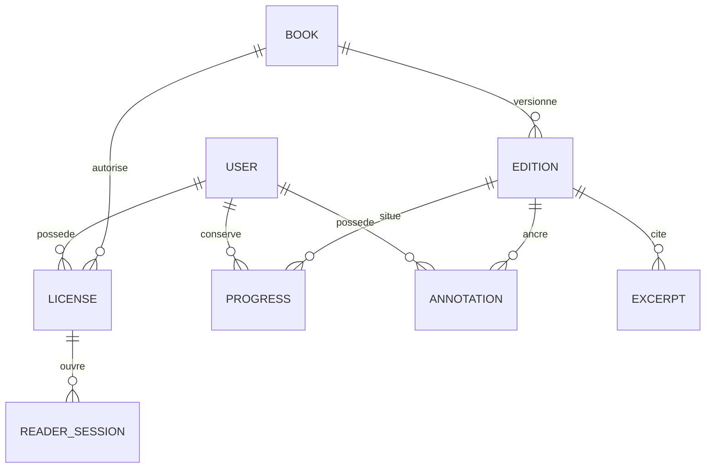

# Modèle de données et invariants

Aucune migration introduite par ce lot. Inspection des migrations, pas d'introspection de la base en production. Schéma cible à produire seulement après inventaire des achats et ressources dans un environnement de qualification.

## Réutilisation et extensions

| Entité | Existant | Décision et contraintes cibles |
| --- | --- | --- |
| users | Compte, profils communauté, relations | Réutiliser ; propriétaire déduit du cookie. |
| books / authors | Catalogue et chemins PDF/EPUB ; droits éditoriaux | Réutiliser. Distinguer droit commercial, droit personnel et politique de citation/audio. |
| orders / order_items | Achat ebook, token, statut completed | Inchangés. Source historique du droit ; aucun nouveau traitement de paiement. |
| reading_progress | Unique user_id/book_id, format, page, total, %, CFI, chapitre, durée, dates | Source de vérité conservée. Ajouter edition_id, revision bigint, locator JSON ; préserver champs legacy pendant transition. Corriger capacité CFI avec migration additive validée. |
| reading_licenses | Absent | À créer lorsque révocation/grant nécessitent cycle autonome : id opaque, user_id, book_id, source_order_item_id nullable, status, granted_at, expires_at, revoked_at/reason. Unicité de source, index user/book/status ; plusieurs sources possibles sans perdre un achat valide. |
| reading_editions / reading_assets | Absents | Édition immuable par empreinte du fichier et version de traitement. Assets format, taille, sha256, pages/spine, text_version, storage_key privé, qualification_status, politique éditoriale. Le fichier remplacé crée une nouvelle édition. |
| reading_sessions | Sessions Reader absentes, sessions web déjà présentes | Ne pas confondre. Licence, utilisateur, device_id, expiration, revoked_at, heartbeat, compteur d'opérations. Limite appliquée atomiquement en base. |
| reading_devices | Absent | Identifiant aléatoire par installation, nom choisi, dates ; pas d'empreinte matérielle intrusive. Un device n'est pas une identité. |
| reading_bookmarks | Absent | Plusieurs par compte/livre/édition ; locator JSON et label. Index owner/book/edition. |
| reading_annotations | Absent | Une table pour note et highlight avec type, locator, body nullable, couleur sémantique, revision. Pas de table reading_highlights séparée sans besoin démontré. Accès owner seulement. |
| reading_audio_positions | Absent | Sous-objet audio dans progression au départ : segment/char_offset, track_id/time_ms si piste. Séparer plus tard seulement si plusieurs pistes indépendantes le justifient. |
| reading_operations | Absent | Clé unique user/book/operation_id, empreinte du payload et résultat/révision pour retries. Expiration documentée après fenêtre hors connexion supportée ; même ID/données différentes = 409. |
| shared_excerpts | Absent | Édition, locator, texte approuvé, auteur publication, groupe/post, attribution figée, policy_version, état modération. Jamais annotation_id comme accès implicite à note. |
| excerpt_discussions | Messages de groupes existants | Réutiliser reading_group_posts, ajouter excerpt_id/parent_id si besoin ; pas de nouveau moteur de forum. |
| reading_audit_events | Absent | Événements dédiés ou canal structuré retenu après charge ; identifiants pseudonymes, motif normalisé et request_id. Pas de texte de l'ouvrage/notes. |

## Relations cibles

Les références étrangères ne suffisent pas à isoler deux comptes. Les requêtes commencent par owner_id et vérifient édition/livre. Les ressources privées d'autrui répondent 404 ; les demandes d'accès à un livre connu sans droit répondent 403.

## Identifiants de passages

Prototype : `edition_id = sha256:<empreinte originale>`. Cible : id d'édition opaque et empreinte interne, plus processing_version/text_version. Même original traité différemment doit pouvoir produire une version d'ancrage distincte.

PDF : page physique 1-based ; `page_label` éditorial distinct, rectangles normalisés [0,1] et quote selector exact/prefix/suffix ; offsets UTF-16 dans le texte canonique de la version déclarée. L'ordre de lecture du texte extrait doit être qualifié, notamment colonnes, ligatures et accents. Aucun offset ne devient fiable sans cette version. `textAnchor` réalise le contrat minimal de qualification.

EPUB : spine href canonique, CFI range et quote selector. Une page calculée par la fenêtre n'est pas un identifiant permanent. Reflow et zoom ne changent pas la position logique.

## Changement de fichier ou d'édition

Conserver ancienne édition et annotations selon droits/rétention. Ne jamais rattacher par simple numéro de page à une nouvelle édition. Créer un mapping de réancrage en job, avec confiance et statut pending/confirmed/orphaned ; demander confirmation pour une correspondance ambiguë. La progression vers une nouvelle édition repart sur une position explicitement convertie ou reste sur l'ancienne. La citation publiée garde édition et attribution historiques ; retrait éditorial peut masquer le texte.

## Déploiement des schémas ultérieurs

Expand, backfill idempotent, vérification des comptes/achats, comparaison des lectures, bascule puis éventuel retrait dans un autre lot. Sauvegarde et restauration testées, aucune suppression automatique. Compter les conflits user/book et les tokens orphelins sans les journaliser. Ne pas inventer de licences pour des commandes non terminées ou pour le témoin scolaire.
